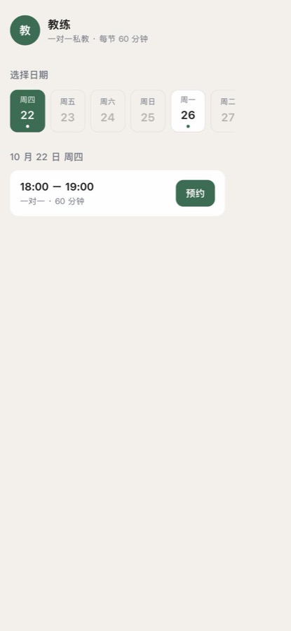
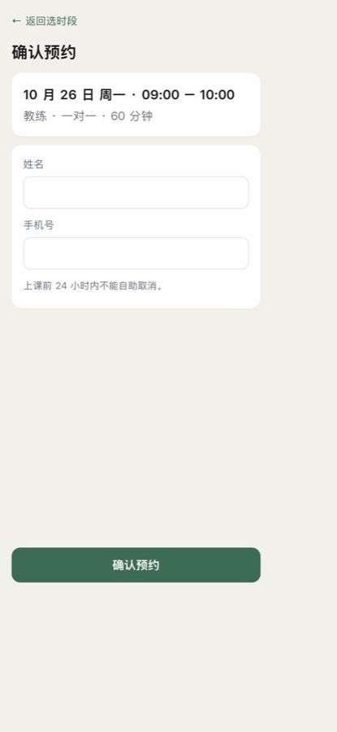
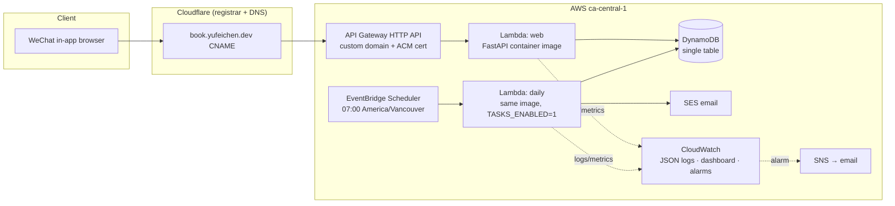
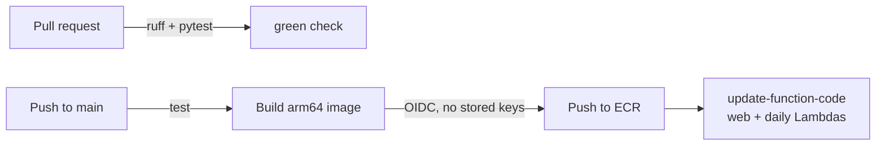
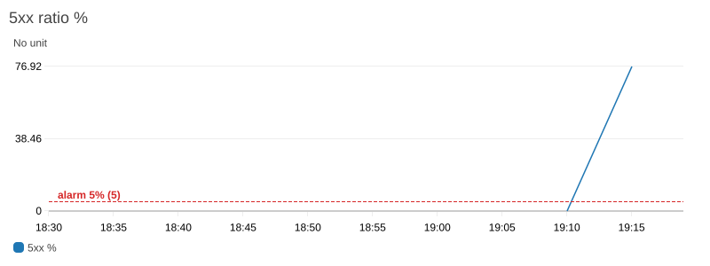
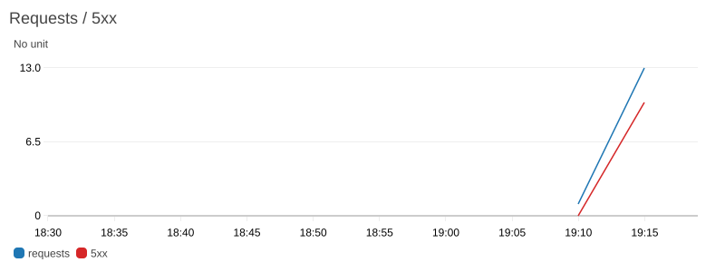

# solo-booking

[](https://github.com/yufei339/solo-booking/actions/workflows/ci.yml)

A mobile-first booking page for a solo fitness coach whose clients all live in WeChat.
Clients open a link, see real availability for the next 14 days, and book a 1:1 session
with just a name and phone number. The coach manages her weekly schedule, days off and
bookings from a password-protected admin page, and gets the day's schedule by email every
morning.

**Live:** https://book.yufeichen.dev (admin at `/admin/login`)

Built in ten working days as a deliberate exercise in shipping a small product with
production-grade infrastructure: serverless on AWS, infrastructure as code, zero-secret
CI/CD, and real observability. [中文摘要在文末](#中文摘要).

<table>
  <tr>
    <td></td>
    <td></td>
  </tr>
</table>

## Why

The coach was scheduling every session by hand in WeChat DMs: "Is Wednesday free?"
"No." "Thursday?" A link that shows live availability removes the back-and-forth, and a
conditional write in the database guarantees two clients can never grab the same slot.

Scope was fixed up front from a 20-minute interview with the coach: 1:1 sessions, 60
minutes, a mostly-fixed weekly schedule, 24-hour cancellation rule. Payments, memberships,
waitlists, SMS and a WeChat mini-program were explicitly out of scope.

## Architecture





Everything in the AWS and Cloudflare boxes is defined in [`infra/`](infra) with Terraform
(two providers, one `terraform apply`). The CI pipeline is
[`.github/workflows/ci.yml`](.github/workflows/ci.yml).

### Request path

1. Cloudflare answers DNS for `book.yufeichen.dev` with a CNAME to the API Gateway regional
   domain (DNS-only, no Cloudflare proxy, so TLS terminates at API Gateway with an ACM
   certificate).
2. API Gateway forwards every route (`$default`) to the web Lambda as an `AWS_PROXY`
   integration.
3. The Lambda runs the FastAPI app as a container image. The
   [Lambda Web Adapter](https://github.com/awslabs/aws-lambda-web-adapter) extension
   translates Lambda events into plain HTTP against `uvicorn`, so the same image runs
   locally with `docker run` and in Lambda unchanged.
4. Availability is computed on every request: weekly template − days off − existing
   bookings − slots already in the past (America/Vancouver time).

## Design decisions

| Decision | Chosen | Not chosen | Why |
|---|---|---|---|
| Compute | Lambda container image + API Gateway HTTP API | EC2, ECS/Fargate | Pay per request, zero idle cost, no servers to patch. Traffic is tiny and bursty. |
| Lambda adapter | Lambda Web Adapter extension | Mangum | Same image runs locally and in Lambda with no code changes; non-HTTP events (the scheduler) are passed through as a POST, so the daily job is just another route. |
| Database | DynamoDB single table | RDS/Aurora | No connection pool to manage from Lambda, free tier covers it, and the access patterns are three simple key lookups. |
| Double booking | `PutItem` with `attribute_not_exists(PK)` | Locks, transactions | The slot *is* the primary key, so DynamoDB serialises concurrent writes for free. [See below](#no-double-booking). |
| Scheduled job | Second Lambda from the same image, invoked by EventBridge Scheduler | Separate handler/package, EventBridge Rule | One image to build and deploy. Scheduler supports time zones natively, so `cron(0 7 * * ? *)` in `America/Vancouver` survives DST. The job route only exists when `TASKS_ENABLED=1`, and that function has no API Gateway, so it cannot be triggered from the internet. |
| CI/CD auth | GitHub OIDC → short-lived STS credentials | Long-lived access keys in repo secrets | A public repo with stored AWS keys is one leak away from a bill. The trust policy pins the repo *ID* (GitHub immutable subject), not just the name, and the role can only push one ECR repo and update two Lambdas. |
| Deploy gate | `needs: test`, `concurrency: deploy-main`, image tag = git SHA | Deploy on every push | Red tests never deploy; rapid pushes cannot overwrite a newer image with an older one; the running commit is visible in the Lambda config and rollback is one `update-function-code`. |
| Secrets | Lambda environment variables via sensitive Terraform vars | Secrets Manager | Encrypted at rest with KMS, zero cost, no startup fetch. Right size for a single-tenant app; Secrets Manager is the upgrade path if rotation is ever needed. |
| Auth | Coach: single password + signed session cookie. Clients: name + phone, cancel via tokenised link | Accounts for everyone | Clients arrive from WeChat; a sign-up form is the first drop-off point. The coach is one person. |
| Domain / DNS | Bought on Cloudflare; DNS records written by the Cloudflare Terraform provider | Route 53 for everything | Route 53 registration failed on a new account (fraud screening). Cloudflare Registrar does not allow custom nameservers on the free plan, so DNS stays there and Terraform manages both clouds. |
| Time | All times stored as local Vancouver strings | UTC | Coach and clients are in one city; storing local time removes a whole class of off-by-one-day bugs. |

## No double booking

A booking is stored with `PK = BOOKING#<date>`, `SK = <time>`. Two clients booking the same
slot therefore write the *same* item. The write is conditional:

```python
table.put_item(
    Item=item,
    ConditionExpression="attribute_not_exists(PK)",
)
```

DynamoDB evaluates the condition atomically on the server, so exactly one write succeeds
and the other raises `ConditionalCheckFailedException`, which the app turns into a
"someone just took this slot" page (HTTP 409). No locks, no transactions, no retry loop.

The race is covered by a test that bypasses the pre-check and asserts the second write
fails: [`tests/test_booking.py`](tests/test_booking.py)
(`test_race_between_check_and_write_gets_409`).

## Observability

**Structured logs.** A middleware emits one JSON line per request; unhandled exceptions are
logged with the stack trace and turned into a friendly 500 page.

```json
{"ts": "2026-10-17T19:16:38+0000", "level": "INFO", "logger": "solo_booking", "msg": "request",
 "data": {"method": "POST", "path": "/admin/boom", "status": 500, "duration_ms": 0.8,
          "request_id": "Root=1-6ad3c996-0125910272fbe16c2b879fa2;..."}}
```

CloudWatch Logs Insights parses the JSON, so `filter data.status >= 500 | stats count() by data.path`
works without any extraction rules.

**Alarms** (all → SNS → email, all `treat_missing_data = notBreaching` so a quiet night is
not an incident):

| Alarm | Rule | Why this shape |
|---|---|---|
| 5xx ratio | `IF(requests >= 5, 100 * errors / requests, 0) > 5` over 5 min | A ratio, not a count, with a floor on request volume: at low traffic one error is 100 %. |
| p95 latency | `Latency p95 > 3000 ms` for 2 consecutive 5-min windows | A Lambda cold start is ~5 s; at low traffic one cold start dominates a single window's p95. |
| Lambda errors (web, daily) | `Errors >= 1` in 1 h | Catches timeouts, crashes and failed emails. Distinct from HTTP 5xx: an exception the app handles is a successful invocation. |

**Dashboard.** Requests/4xx/5xx, p50/p95 latency, 5xx ratio, Lambda duration/concurrency/errors,
daily-job invocations, alarm status, and a Logs Insights panel of recent 5xx requests.

<table>
  <tr>
    <td></td>
    <td></td>
  </tr>
</table>

**The drill found a real bug.** To test the alarms I added an admin-only `POST /admin/boom`
that raises, and hit it ten times. The 5xx alarm fired within two minutes as designed, but
the *Lambda errors* alarm fired too, which it should not have: the app handled every
exception. The logs showed why. Starlette's `ServerErrorMiddleware` sends the 500 response
and then re-raises so the server can log it; `uvicorn` then closes the connection. The
Lambda Web Adapter reuses keep-alive connections, so half the invocations failed with
`connection closed before message completed` and clients got a bare API Gateway 500
instead of the app's error page. Fix: catch exceptions inside the app's own middleware and
return the 500 page from there, so nothing propagates to the server. After the fix, ten
booms produced ten HTTP 500s and zero Lambda errors.

## Cost

At the coach's traffic (tens of bookings a month):

| Item | Monthly |
|---|---|
| Lambda, API Gateway, DynamoDB, SES, EventBridge Scheduler | $0 (free tier) |
| CloudWatch (4 alarms, 1 dashboard, 14-day log retention) | $0 (free tier) |
| Cloudflare domain `yufeichen.dev` | ~$1 ($12.20 / year) |
| **Total** | **~$1** |

Terraform sets `ignore_changes = [image_uri]` on both Lambdas: infrastructure shape belongs
to Terraform, the running version belongs to CI.

## Data model

One DynamoDB table, two string keys.

| Entity | PK | SK | Attributes |
|---|---|---|---|
| Weekly template (1 item) | `COACH` | `TEMPLATE` | `slots`: `{"0": ["09:00", "10:00"], ...}` keyed by weekday 0–6 |
| Day off | `COACH` | `DAYOFF#2026-10-15` | – |
| Booking | `BOOKING#2026-10-15` | `10:00` | `name`, `phone`, `token` (cancel secret), `created_at` |

Everything the coach configures shares `PK = COACH`, so the template and all future days
off come back from one `Query`. Bookings are keyed by date so a day's schedule is one
`Query` and a slot is one `GetItem`.

## Running it

```bash
uv sync                                   # Python 3.12, deps from uv.lock
cp .env.example .env                      # ADMIN_PASSWORD, SESSION_SECRET, COACH_*
uv run --env-file .env uvicorn app.main:app --reload --no-access-log
uv run pytest                             # 44 tests, DynamoDB mocked with moto
uv run ruff check . && uv run ruff format --check .
```

Local runs talk to the real DynamoDB table using your AWS credentials; tests never do.

Deploying:

```bash
cd infra && terraform init && terraform apply   # one-time infra; secrets in terraform.tfvars
git push origin main                            # CI builds, pushes and swaps the image
```

## Repository layout

```
app/
  main.py           FastAPI app, middleware wiring
  admin.py          coach pages: login, weekly template, days off, bookings
  booking.py        client pages: book, confirmation, cancel
  availability.py   availability + cancellation rules (pure functions)
  db.py             DynamoDB access, conditional write
  tasks.py          daily email (scheduler pass-through route)
  observability.py  JSON logging middleware
  templates/        Jinja2, mobile-first, no frontend framework
infra/              Terraform: ECR, Lambda ×2, API Gateway, DynamoDB, Scheduler, SES,
                    CloudWatch, SNS, IAM/OIDC, ACM, Cloudflare DNS
tests/              pytest + moto; clock is frozen in every time-dependent test
.github/workflows/  ruff + pytest on PRs; build → ECR → Lambda on main
```

## What I would do next

- Client history page in the admin (bookings per phone number). The data is already there.
- Email the coach on cancellation, not just in the morning digest.
- A "reschedule" action (currently cancel + rebook).
- Move secrets to Secrets Manager if a second tenant ever appears.

## 中文摘要

给一位独立健身教练做的约课页面。客户在微信里打开链接，看到未来 14 天的真实空位，填姓名和手机号即可预约；教练在后台维护每周可约时段、请假日和预约列表，每天早上收到当日课表邮件。

用 10 个工作日完成，目的是用一个小产品练一遍生产级的基础设施：

- **运行**：FastAPI 打成容器镜像跑在 Lambda 上，经 Lambda Web Adapter 转成普通 HTTP，本地和线上同一个镜像；API Gateway 提供 HTTPS 入口，自定义域名 + ACM 证书。
- **数据**：DynamoDB 单表；并发预约靠条件写入 `attribute_not_exists(PK)`，同一时段天然只成功一个，不用锁。
- **定时任务**：同一镜像起第二个 Lambda，EventBridge Scheduler 按温哥华时区每天 07:00 触发，SES 发邮件；该函数不挂 API Gateway，路由只在 `TASKS_ENABLED=1` 时存在。
- **CI/CD**：PR 跑 ruff + pytest；合并到 main 自动构建 arm64 镜像、推 ECR、更新两个 Lambda。GitHub OIDC 换短期凭证，仓库里零密钥，信任策略锁定仓库 ID。
- **可观测性**：每请求一行 JSON 日志；4 条告警（5xx 比例带请求数门槛、p95 延迟连续两窗口、两个函数的 Lambda Errors）→ SNS 邮件；CloudWatch 看板。故意制造 500 做演练时发现一个真 bug：异常冒到 uvicorn 会关闭连接，导致 Web Adapter 的复用连接失败、一半请求变成 Lambda 调用失败；改为在中间件内就地处理后归零。
- **基础设施**：全部 Terraform，AWS 和 Cloudflare 两个 provider 一次 apply。
- **成本**：约每月 1 美元（只有域名费）。
